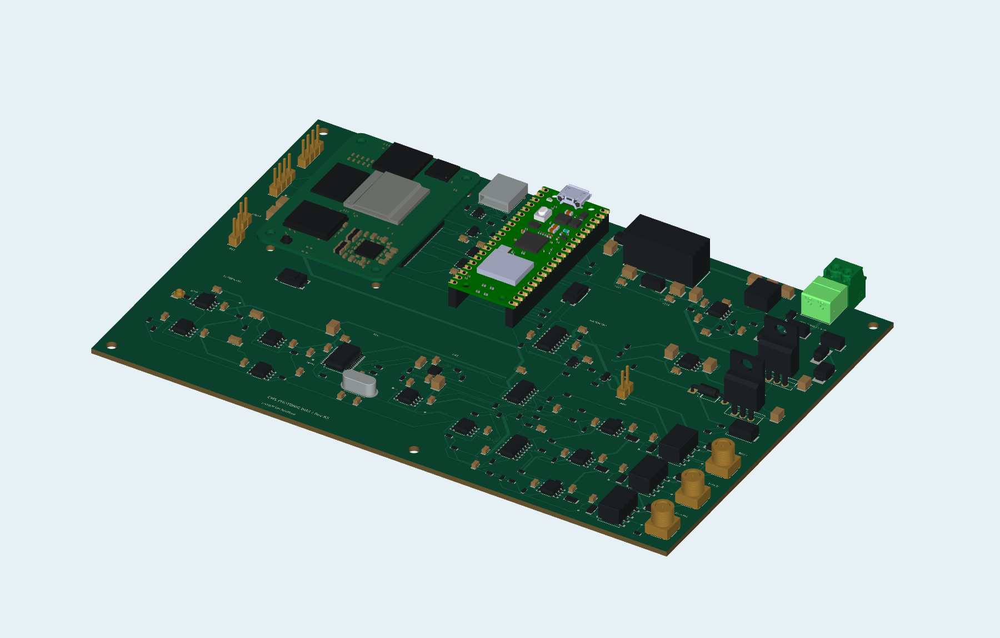

# Controlador de polarização MZM com CM5 e RP2040

**Projeto 3 **

Placa-base com Raspberry Pi Compute Module 5 e Raspberry Pi Pico para adquirir o sinal de um fotodiodo, gerar três tensões de polarização e supervisionar as saídas de um modulador Mach–Zehnder (MZM). O CM5 participa da supervisão; o Pico, baseado no RP2040, faz a interface com o ADC e o DAC. O acionamento dos relés depende da atividade dos dois controladores e da ausência de falha.

O repositório reúne o projeto nativo do Altium, 14 circuitos de simulação no LTspice, relatórios e recursos de montagem 3D. Os resultados documentados incluem cálculos nominais e simulações. Firmware embarcado e registros de validação física ainda não estão publicados neste repositório.



## Documentação

| Documento | Conteúdo |
| --- | --- |
| [Relatório principal](docs/relatorios/Relatorio_CM5_RP2040_MZM.docx) | Arquitetura, circuitos, interfaces e bancada óptica |
| [Conexões em 3D](docs/relatorios/Relatorio_Conexoes_3D%20.docx) | Exemplos de ligação em J104, J103, JP100, JP101 e SW1000 |
| [Ensaios de bancada](docs/relatorios/Ensaios_de_Bancada_CM5_Photonic_Bias.docx) | Sequência de verificações e medidas do protótipo |
| [Relatório LTspice](docs/relatorios/Relatorio_LTspice_CM5_RP2040_MZM.docx) | Circuitos, gráficos e análise das simulações |
| [Lista de compras](docs/relatorios/Lista_Compras_Prototipo_CM5_RP2040%20.xlsx) | Planilha de componentes e acessórios |
| [Vídeo da montagem e da bancada](media/CM5_R6_Trailer_Bancada.mp4) | Animação da placa e do conjunto com MZM |

Para preparar a aquisição, use a [configuração de referência do ADS1256](#configuração-do-adc-ads1256) descrita abaixo. Ela consolida a escolha do buffer e a faixa operacional para a R6.

## Abrir o projeto no Altium

1. Baixe o repositório por **Code → Download ZIP** e extraia todas as pastas, ou faça o clone:

   ```bash
   git clone https://github.com/CarloRenan/Projeto3-CM5-RP2040-MZM.git
   ```

2. Abra [`CM5_Projeto3_R6.PrjPcb`](hardware/altium/CM5_Projeto3_R6.PrjPcb) no Altium Designer.
3. Abra a PCB disponível nesta revisão: [`CM5_R6_Serigrafia_VIRTUS.PcbDoc`](hardware/altium/CM5_R6_Serigrafia_VIRTUS.PcbDoc). As teclas **2** e **3** alternam as vistas 2D e 3D.
4. Mantenha a biblioteca [`CM5_Projeto_R6.PcbLib`](hardware/altium/CM5_Projeto_R6.PcbLib) e as subpastas de modelos nas posições originais.

O `.PrjPcb` ainda contém uma referência ao nome anterior `CM5_Projeto3_R6.PcbDoc`. Se a PCB aparecer como ausente na árvore do projeto, abra diretamente o arquivo indicado no passo 3. Para corrigir a associação na cópia local, use **Add Existing to Project** e retire da árvore apenas a referência antiga.

## Arquitetura e sinais

O caminho de leitura passa pelo fotodiodo, pelo amplificador de transimpedância (TIA) e pelo filtro de `PHOTO_ADC`, antes de chegar ao ADS1256. O resistor de realimentação `R500` é de **220 kΩ**. O ADC também lê os monitores dos três canais de BIAS, de forma multiplexada.

Na geração do BIAS, o DAC80504 alimenta os drivers I, Q e PHI. A relação nominal de cada driver é `V_DRV ≈ 6,34 × (V_DAC − 1,25 V)`. Depois do driver, o sinal passa pelo resistor de **220 Ω**, pelo filtro e pelo relé. A tensão entregue à carga depende dessa resistência série e da impedância conectada à saída.

Os sinais `MON_I`, `MON_Q` e `MON_PHI` observam o BIAS filtrado **antes do relé**. Para verificar a tensão efetivamente entregue ao conector, meça o ponto de teste posterior ao contato.

| Interface ou ponto | Função |
| --- | --- |
| J200 | Entrada de alimentação: pino 1 = +15 V; pino 2 = GND |
| J500 | Entrada elétrica do fotodiodo: centro = cátodo/sinal; blindagem = ânodo/GND |
| J700 / J800 / J900 | Saídas de polarização BIAS I / Q / PHI |
| J102 | USB 2.0 do CM5 para acesso e programação, conforme a variante do módulo |
| TP500 / TP501 | `TIA_OUT` e `PHOTO_ADC`, respectivamente |
| TP700 / TP701 | Canal I antes e depois do relé |
| TP800 / TP801 | Canal Q antes e depois do relé |
| TP900 / TP901 | Canal PHI antes e depois do relé |

A pinagem completa está em [`Conectividade_pinos_R6.csv`](hardware/altium/Conectividade_pinos_R6.csv). A [BOM do sistema](hardware/altium/BOM_Sistema_R6.csv) reúne componentes e acessórios; o [arquivo de posicionamento](hardware/altium/Posicionamento_R6.csv) permite localizar os designadores na placa.

## Conexões dos acessórios

J103 e J104 usam headers de quatro posições com passo de **2,54 mm**. Confira a função de cada terminal do acessório antes de montar o cabo: a ordem e as cores dos fios de um produto comercial podem ser diferentes das usadas nas ilustrações.

| Pino | J103 — display ou periférico I²C | J104 — ventilador de quatro fios |
| --- | --- | --- |
| 1 | `CM5_3V3` — saída de 3,3 V | `GND` |
| 2 | `GND` | `+5V_SYS` — alimentação de 5 V |
| 3 | `CM5_SDA` — dados | `CM5_FAN_TACH` — leitura de rotação |
| 4 | `CM5_SCL` — clock | `CM5_FAN_PWM` — controle de velocidade |

Em **J103**, use um periférico com alimentação e lógica compatíveis com 3,3 V. Esse ramo vem do CM5 e depende de sua alimentação ativa. O pino 1 é uma saída: não conecte outra fonte nesse terminal. Em **J104**, use um ventilador de 5 V com interface de controle compatível; a alimentação do motor vem de `+5V_SYS` e pode permanecer presente mesmo com o CM5 desligado.

### Jumpers e chave externa

| Designador | Pino 1 | Pino 2 | Uso |
| --- | --- | --- | --- |
| JP100 | `CM5_BOOT_N` | `GND` | Ponte para selecionar o boot por USB; aberto na partida normal |
| JP101 | `CM5_PMIC_EN` | `GND` | Ponte de manutenção que mantém PMIC_EN baixo; aberto no uso normal e na programação |
| SW1000 | `+5V_SYS` | `COIL_5V` | Ponte ou chave externa no caminho de alimentação das bobinas dos relés |

Instale ou retire as pontes com a placa desenergizada. Para o boot por USB, feche JP100, mantenha JP101 e SW1000 abertos e conecte um cabo de dados a J102. A alimentação principal continua entrando por J200. O procedimento de gravação depende da variante do CM5; a versão Lite não possui eMMC. Ao terminar, desligue a placa e retire a ponte de JP100.

Antes de usar JP101, encerre corretamente o sistema operacional. Essa ponte atua no estado de alimentação do CM5; os demais ramos da placa podem continuar energizados quando J200 está alimentado.

Em **SW1000, nenhum dos pinos é GND**. Uma chave externa deve usar um contato seco entre os dois terminais, com capacidade de interrupção adequada à corrente das bobinas. Não deixe uma ponte em paralelo com a chave.

## Configuração do ADC ADS1256

A configuração de referência para implementar e verificar na R6 é **buffer ligado (`BUFEN = 1`) e `PGA = 1` em todos os canais utilizados**. O buffer reduz o carregamento das redes MON, que também participam da proteção analógica. Essa escolha exige limitar a tensão do caminho fotodetector.

| Parâmetro | Configuração de referência |
| --- | --- |
| Alimentação analógica | `AVDD5` nominal de 5 V; conferir a faixa de 4,75 a 5,25 V |
| Referência | `REF_ADC` nominal de 2,5 V; usar o valor medido na conversão |
| Entradas | AIN0 = `PHOTO_ADC`; AIN1/2/3 = `MON_I` / `MON_Q` / `MON_PHI`; AINCOM = GND |
| Buffer e ganho | `BUFEN = 1`; `PGA = 1` |
| Faixa operacional adotada | **0 a 2,6 V** nas entradas utilizadas, incluindo os picos em TP501 |
| Comparação em DC | 60 amostras/s |
| Ensaio de 17 Hz | 1.000 amostras/s, inicialmente com AIN0 fixo |

O [datasheet do ADS1256](https://www.ti.com/lit/ds/symlink/ads1256.pdf) especifica, com buffer ligado, entradas entre GND e `AVDD − 2 V`. O teto é 3 V com AVDD de 5 V, mas cai para 2,75 V com AVDD de 4,75 V. **O limite de 2,6 V é uma escolha operacional do projeto**, com margem em relação a esse segundo caso.

Com `R500 = 220 kΩ` e nível escuro nominal próximo de 0,248 V, uma fotocorrente de **10 µA** produz aproximadamente **2,448 V** no modelo linear. Adota-se essa corrente total, incluindo os picos, como referência inicial de bancada, sempre confirmando a tensão real em TP501. Uma curva analógica calculada até 20 µA não comprova aquisição válida nessa faixa com o buffer ligado.

O ADS1256 possui um conversor compartilhado: a taxa programada não é uma taxa simultânea garantida por canal. O firmware deve configurar os registros, concluir a calibração, respeitar `DRDY` e a acomodação após a troca de entrada, além de registrar a taxa efetiva. Esta seção define os parâmetros a implementar e verificar; não representa firmware já validado na placa.

## Relés e conferência de bancada

Fechar SW1000 permite alimentar as bobinas, mas os relés só são acionados quando Q1000 também recebe autorização. Na lógica da R6, `RELAY_EN = WD_MCU ∧ WD_CM5 ∧ FAULT_N`; o Pico participa do bloqueio dos temporizadores por `MCU_ARM`.

Com as bobinas desenergizadas, cada saída fica ligada ao GND por **1 kΩ**. O driver anterior ao relé pode manter tensão. Por isso, o teste de desarme compara os pontos antes e depois do contato, sem concluir o estado da saída apenas pela leitura de MON.

1. Comece com a fonte desligada, o MZM desconectado, JP100 e JP101 abertos e SW1000 aberto.
2. Confira a polaridade de J200, a continuidade dos cabos e possíveis curtos. Verifique as fontes antes de liberar as saídas.
3. Teste ventilador e periférico I²C. Desligue a placa antes de inserir ou retirar seus cabos.
4. Confirme a configuração do ADC e os picos de TP501. Registre as tensões de alimentação e referência usadas no ensaio.
5. Ensaie os relés com carga de teste e comando de pequena amplitude. Compare os pontos de teste ao abrir SW1000 e ao retirar as permissões lógicas, seguindo o [roteiro de bancada](docs/relatorios/Ensaios_de_Bancada_CM5_Photonic_Bias.docx).

## Simulações no LTspice

Abra um arquivo `.asc` em [`simulacoes/LTspice`](simulacoes/LTspice) e execute **Run**. Mantenha os símbolos `.asy` na mesma pasta e a pasta `modelos` ao lado de `LTspice`. As netlists `.cir` registram as equações e os estímulos.

O [roteiro dos 14 ensaios](simulacoes/README.md) abrange TIA, filtro, drivers de BIAS, cargas, desarme, proteção, watchdog, referências, alimentação e MZM em malha aberta. Os amplificadores usam os macromodelos indicados nos arquivos; outros blocos usam representações funcionais. O buck com PWM fixo e o MZM ideal têm hipóteses declaradas, que devem ser consideradas ao interpretar os resultados.

## Organização do repositório

| Pasta | Conteúdo |
| --- | --- |
| [hardware/altium](hardware/altium) | Projeto, 17 esquemáticos, PCB, biblioteca, BOM, conectividade e posicionamento |
| [hardware/altium/ALTIUM_EMBEDDED_MODELS](hardware/altium/ALTIUM_EMBEDDED_MODELS) | Modelos mecânicos dos componentes |
| [simulacoes/LTspice](simulacoes/LTspice) | Circuitos `.asc`, netlists `.cir` e símbolos `.asy` |
| [simulacoes/modelos](simulacoes/modelos) | Macromodelos dos amplificadores e blocos funcionais |
| [docs/relatorios](docs/relatorios) | Relatórios técnicos, roteiro de bancada e planilha de compras |
| [docs/imagens](docs/imagens) | Vistas da placa, montagem e bancada |
| [docs/modelos_referencia](docs/modelos_referencia) | Modelo detalhado do CM5 usado na documentação |
| [media](media) | Animação da montagem e da bancada óptica |

O [histórico de alterações](CHANGELOG.md) registra as revisões do pacote. As cenas 3D são representações de montagem. A origem e as condições dos recursos de terceiros estão em [THIRD_PARTY.md](THIRD_PARTY.md) e nos arquivos de identificação que acompanham os modelos.

## Autores

- Carlos Renan Correia Fidelis
- Carlos Elias Fialho de Lima
- Pablo Daniel Nascimento Vieira

Universidade Federal de Campina Grande · Engenharia Elétrica · 2026.
